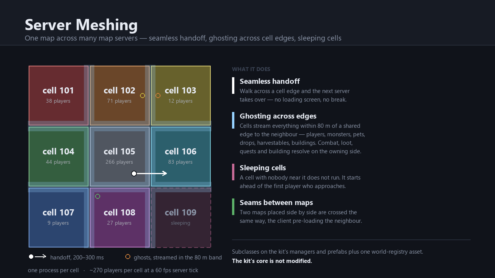

# Server Meshing

Splits one map across several map-server processes — **cells** — with seamless handoff. A player walking over a cell
edge is handed to the next server without a loading screen and without a visible break (200–300 ms server side, hidden
behind stand-ins on the client). Neighbouring cells exchange **ghosts** of everything within 80 m of their shared edge —
players, monsters, pets, drops, harvestables, buildings — so players see and fight across it, and hits, kills, loot,
party and guild rewards, quest counters, buildings and pickups all resolve on the owning side.

Maps can be placed next to each other in one world; a **seam** between two maps is crossed the same way, with the client
pre-loading the neighbouring scene behind the player's back. Cells can be any size — small where crowds are expected,
large over empty land — and with **sleeping cells** on, a cell with nobody near it does not run at all: it starts a few
seconds ahead of the first player who approaches, and exits again later. Empty land costs nothing.

A map set **Dynamic** has its cells cut and merged at runtime: by an operator's command, or by the central's own
policy, which reads every cell's load report, splits a cell that stays hot along the cut its cost model says relieves
it most (only when that is worth a process), merges a pair that would be cool together, measures every operation it
made, and restarts or collapses a child that dies. A cell cut off from the cluster fences itself so two processes
never own one piece of ground, buildings follow the cut (a chest and its contents move with the ground they stand
on), and a central that restarts adopts the cut layout the cells hold and finishes the operation it was running.

The add-on is subclasses on the kit's managers and entity prefabs plus one world-registry asset; the package changes no
kit file. It does build on **eight small kit changes** (bug fixes and extension seams, DESIGN §17), all of them in
OpenMMORPG **v1.1.4** (see Requirements).

- One cell process holds about **270 players at a 60 fps server tick** on a modern core; size cells so no expected crowd
  exceeds 250 (250–300 m suits a sandbox where towns can appear anywhere).
- Ten cells over two maps are exercised by the regression harness of the [test rig](#the-test-rig) in the source
  repository, on one machine or across two: 35 scenarios, twenty-two of them dynamic cells (two run with links on demand, one
  is the operator's `unfreeze` of a family a central restart left frozen, and one a three-hour soak of automatic splits
  and merges under kills and central restarts) and two on-demand links. Across two
  machines the dynamic scenarios run with the cut family on the second machine's own map spawner.

## Requirements

- **OpenMMORPG v1.1.4** (`master` at 317d2b8, 2026-10-25) or later. It carries everything the add-on relies on:
  - the eight kit changes, upstream patches 0001-0008: an owner-change movement fix, frame-granular request waits, a
    virtual `IsWatched()` on the monster activity component, a protected pending-spawn dictionary on the map manager
    (0001-0004), a cache finalizer that corrupted pooled collections under load (0005), one-shot movement flags sent to
    every receiver of a tick and entity states read to their length (0006-0007), and a virtual
    `BuildingPersistenceChannelId` on the kit's `MapNetworkManager` ([open-mmorpg/OpenMMORPG#8](https://github.com/open-mmorpg/OpenMMORPG/pull/8)), which `MeshMapNetworkManager`
    overrides so a Dynamic map's split family keeps its buildings under the base cell's channel (0008). The add-on does
    not compile without 0006 or 0008;
  - the slot-indexed damage amounts (`DamageElementMinMaxFloatAmounts`, upstream 74ec05b) that replaced the kit's
    `Dictionary<DamageElement, MinMaxFloat>` through its attack, skill and receive-damage paths. 0.95.0 is the port: the
    add-on's attack and skill components, the harvestable and the ghost-hit forwarding use the structs. Versions up to
    0.94.0 used the dictionaries and do not compile on v1.1.4 (`no suitable method found to override` on
    `ApplyAttack`, `ApplySkillUsing` and `ApplyReceiveDamage`).
- Unity 6000.3 or newer, matching the kit.
- Your map scenes in the build settings and your map infos in the game database.

## Usage

1. Import the package, then open **Tools ▸ Open MMORPG ▸ Server Meshing ▸ Setup**. The window has four panels that follow this order.
2. **Create the world registry** — one asset for the whole world.
3. **Cut a map into cells**: add your map's layout from the open scene, either as a uniform grid or as explicit
   rectangles. Cell ids are channel ids and must be unique across the world.
4. Press **Validate** and use the **Fix** buttons to put the add-on's subclasses onto your manager and entity prefabs
   and to assign the registry, the gameplay rule and the server tick. For a map set Dynamic it also says, before
   anything starts, which base cells could never split, whether a fully cut world would pass the 32 band neighbours or
   the 64 links a cell takes when every cell links to every other (a map with `onDemandLinks` links each cell only to
   the cells it needs, and has no such ceiling), and whether the hosts' served cells keep each family on its base's host.
5. Run. The kit's server instance starts one process per cell; with sleeping cells on, cells start on demand.

`Documentation/SETUP.md` in the package is the full operator's guide, `Documentation/DESIGN.md` the design record with
every decision and measurement, and `Documentation/MULTIHOST.md` covers running cells across more than one machine.
`SETUP.md` §6a is the operator's path for Dynamic maps end to end, with their known limits.

**Upgrading from 0.96.0:** that package also carried the source repository's package builder, which adds a
**Tools ▸ Open MMORPG ▸ Server Meshing ▸ Build Packages** menu. 0.96.1 leaves it out, but an import never deletes files:
delete `Mesh/Editor/ServerMeshPackageBuilder.cs` from the installed add-on by hand.

## The test rig

The test rig is not in the package (it was in 0.93.0-0.95.0). It lives in the source repository,
[vaughanb/mmo-server-meshing](https://github.com/vaughanb/mmo-server-meshing): `Assets/ServerMeshing/TestMap` (two test
maps cut into ten cells, a 3×3 grid plus a tenth cell across a seam, with content that exercises every path across a
cell edge, an auto client, an editor launcher and play runner, and a load generator) and the Python regression and
capacity harnesses in `Tools/ServerMeshing/` (the 35 scenarios above). It needs that repository's layout (a server build
at `Build/Server/`, `Config/mySqlConfig.json`), the kit's **BaseDemo**, and Python 3 with `pymysql`; `SETUP.md` §7 and
`MULTIHOST.md` cover running it.

## Licence

MIT, as with the rest of the Open MMORPG add-ons.
