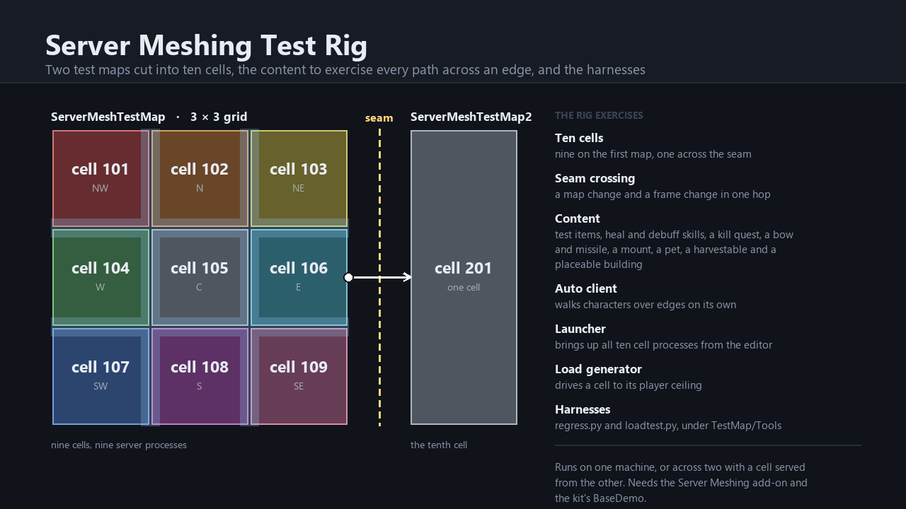

# Server Meshing Test Rig

The test rig for the [Server Meshing](../ServerMeshing) add-on, and the reference for what a meshed world looks like set
up. Two test maps are cut into **ten cells** — a 3×3 grid on one map plus a tenth cell across a seam on the other — with
each zone colour-coded so you can see which server owns the ground you are standing on.

The rig ships the content needed to exercise every path that crosses a cell edge: test items, skills (heal and debuff),
a kill quest, a bow and missile, a mount, a pet, a harvestable and a placeable building. It adds an **auto client** that
walks characters over edges on its own, an editor **launcher** and **play runner** that bring up all ten cell processes,
a **load generator**, and the Python regression and capacity harnesses under `TestMap/Tools`. The regression harness
runs 35 scenarios: eleven of the mesh itself (handoff, ghosts, combat, parties, buildings, seams, sleeping cells),
twenty-two of dynamic cells (split, merge, a three-cell family's merge and sibling collapse, crashes mid-operation, the
automatic policy with one or two hot cells and a host without headroom, buildings across a cut, a central restart, the
last with the central run as a build process of its own so it can be killed alone, and a three-hour soak of automatic
splits and merges under child kills and central restarts; two run with links on demand) and two of on-demand links (a map of more cells than a capped link server takes, and a party share for a far member). With
`--remote-cells` the second machine serves cells too: started by hand for a Static scenario, by its own map spawner
(children, restarts and kills included) for a Dynamic one.

## Requirements

- The **Server Meshing** add-on.
- The kit's **BaseDemo** — the test data and scenes reference its enemy prefab and its default weapon item and type.
- Python 3 and `pymysql` for the harnesses.

## Usage

1. Import the Server Meshing add-on first, then this package.
2. Add `ServerMeshTestMap` and `ServerMeshTestMap2` to the build settings and their map infos to the game database;
   **Server Meshing ▸ Setup ▸ Validate** reports anything still missing.
3. Assign `ServerMeshWorld` as the world registry — it already holds the ten-cell layout and both maps' placement.
4. **Server Meshing ▸ Launch Test Cluster** starts one map-server process per cell (plus the central, login and
   database servers) from a server build, or copies the commands to the clipboard.
5. **Server Meshing ▸ Auto Client ▸ Enable (walk C→E)** makes the editor client walk across a cell edge on its own
   when you enter Play; the other modes cover self-migration and enter-only.

### The harnesses

`TestMap/Tools/` is a reference copy of `regress.py` (the 35 regression scenarios), `loadtest.py` (the capacity
sweep) and their helpers. They are written for the repository layout, not for a location inside `Assets`: they find
the project root two directories above themselves and expect `Config/mySqlConfig.json`, a server build at
`Build/Server/kit-ce-project.exe` and the editor's play runner watching `Temp/`. To run them, copy the folder to
`<project>/Tools/ServerMeshing/` and adjust the build path to your product name. `Documentation/SETUP.md` §7 and
`MULTIHOST.md` in the add-on cover what they do and how to run the rig across two machines.

## Licence

MIT, as with the rest of the Open MMORPG add-ons.
